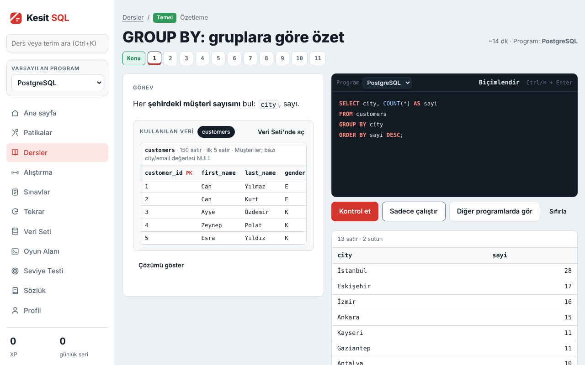
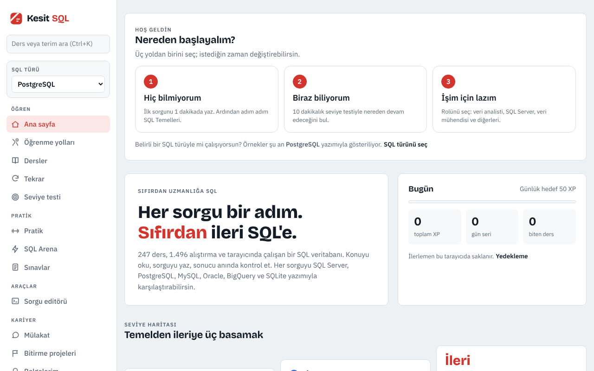
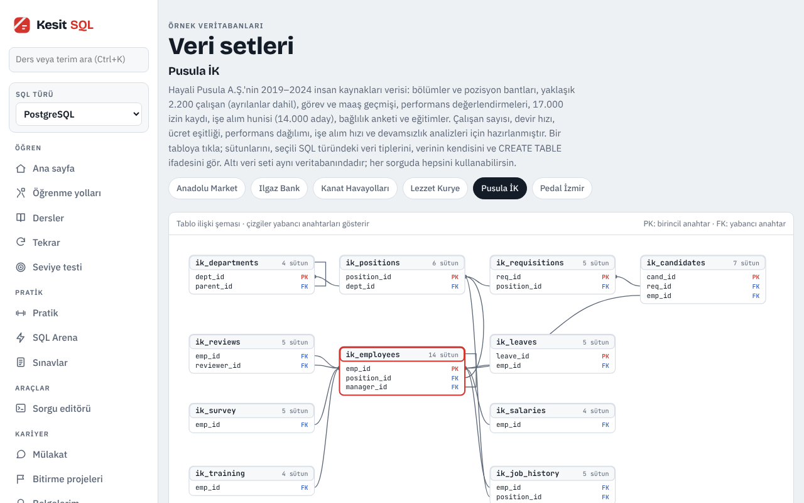
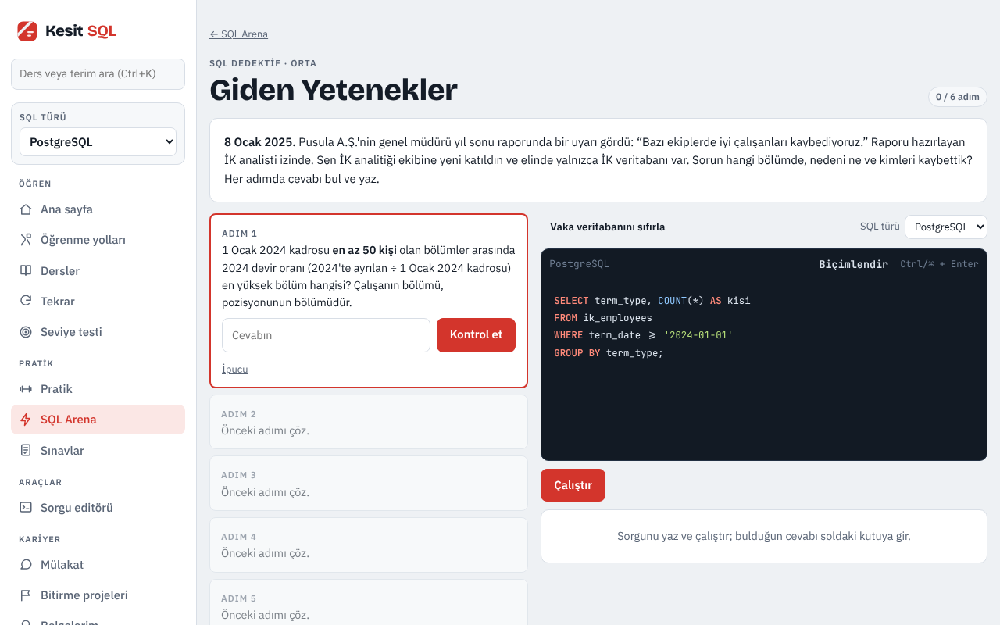

# Kesit SQL

**Sıfırdan ileri seviyeye Türkçe SQL eğitimi. Kurulum yok, hesap yok.** Tarayıcında çalışan bir SQL veritabanıyla öğrenirsin; yazdığın her sorgu anında denetlenir.

**Dene:** https://ysfdurak.github.io/kesit-sql/

## Neler var?
- **271 ders, 1.747 alıştırma, 562 pratik görevi.** İlk sorgudan pencere fonksiyonlarına, sorgu optimizasyonuna, veri ambarına ve mülakat kalıplarına kadar.
- **Altı SQL türü:** SQL Server, PostgreSQL, MySQL, Oracle, BigQuery ve SQLite. Her sorgu seçtiğin türün yazımıyla gösterilir, alıştırmalar o türün kurallarına göre denetlenir.
- **Altı hayali veri seti:** e-ticaret, banka, havayolu, yemek teslimatı, insan kaynakları ve 116.517 yolculukluk bisiklet paylaşımı.
- **20 öğrenme yolu:** 9 rol yolu (veri analisti, BT iş analisti, veri mühendisi, veri bilimci, iş zekâsı, DBA, backend, SQL Server, SQL temelleri), 8 konu yolu (Sorgu Optimizasyonu dahil) ve 3 sertifika hazırlık yolu.
- **SQL Arena:** gizli testli meydan okumalar, SQL dedektif vakaları, sonuç tahmini, sorgu bulmacaları ve haftalık turnuva.
- Seviye testi, sınavlar, aralıklı tekrar, sorgu editörü ve tamamlama belgesi.

| Karşılama | Veri setleri | SQL dedektif |
|---|---|---|
|  |  |  |

## Nasıl çalışıyor?
- Sunucu yok: SQLite, [sql.js](https://github.com/sql-js/sql.js) ile tarayıcıda çalışıyor. Diğer beş SQL türünün yazımı bir çeviri katmanıyla SQLite'ta taklit ediliyor; yazım kuralları, sık hata mesajları ve belirli davranış farkları denetleniyor.
- İlerleme yalnızca kullanıcının tarayıcısında saklanıyor; Profil sayfasından dosyaya kaydedilip başka cihazda yüklenebiliyor. Kişisel veri toplanmıyor.
- Dış bağımlılık yok: SQL motoru ve yazı tipleri sitenin içinde. Site bir kez açıldıktan sonra internet yokken de çalışıyor.
- Bir öğrenme yolunu bitirenler tamamlama belgesi oluşturabiliyor. Belge tarayıcıda üretilir, doğrulanabilir değildir ve resmî bir sertifika yerine geçmez.

## Nasıl doğrulandı?
- Alıştırma ve Arena çözümleri otomatik denetimle **taklit katmanında** altı SQL türünde çalıştırılıyor.
- **PostgreSQL için gerçek motorda** (PGlite, WASM) ayrıca çalıştırılıyor; veri değiştiren görevler ve bisiklet tabloları dahil.
- Sorgu Optimizasyonu derslerindeki PostgreSQL plan çıktıları PGlite ile üretildi, alıştırmaların plan denetimi SQLite planına bakar. Yavaş cevap, sonuç doğru olsa da reddedilir.
- SQL Server, MySQL, Oracle ve BigQuery için gerçek sunucuda test yapılmadı. Bu türlerle ilgili anlatımlar belgelere ve taklit katmanına dayanıyor.
- Denetim betikleri ve komutları `kaynak` dalındaki `araclar/denetim/` ile `NASIL.md` içinde.

## Nasıl yapıldı?
Ürünü, seviye yapısını, öğrenme yollarını ve veri senaryolarını ben kurguladım. Kodun ve içeriğin önemli bölümü yapay zekâ (Claude) ile yazıldı; kalite otomatik denetimlerle sınandı. Site `main` dalından yayınlanır, derleme betikleri ve denetim araçları [`kaynak`](https://github.com/ysfdurak/kesit-sql/tree/kaynak) dalındadır.

## Geri bildirim
Her dersin başlığında **Geri bildirim** bağlantısı var; bu deponun [Issues](https://github.com/ysfdurak/kesit-sql/issues) sayfasını ders bilgisiyle açar.

## Kardeş projeler
Aynı mantıkla hazırlanmış diğer eğitimler: **[Kesit Power BI](https://ysfdurak.github.io/kesit-powerbi/)** ve **[Kesit Python](https://ysfdurak.github.io/kesit-python/)**.

## Sorumluluk notu
Ücretsiz, ticari olmayan bir eğitim ve portföy projesidir; içerik “olduğu gibi” sunulur. Veri setlerindeki tüm şirketler, kişiler ve kayıtlar hayalidir. Sertifika denemeleri ilgili kurumların resmî sınavları değildir.

## Lisans
- Uygulama kodu: [MIT](LICENSE)
- Ders içerikleri ve veri setleri: [CC BY-NC 4.0](LICENSE-ICERIK.md)
- Açık kaynak bileşenler: [sql.js](https://github.com/sql-js/sql.js) (MIT), Bricolage Grotesque, IBM Plex Sans ve JetBrains Mono yazı tipleri (SIL Open Font License; lisans metinleri `vendor/fonts/` klasöründe). Denetimde: [PGlite](https://github.com/electric-sql/pglite) (Apache 2.0 / PostgreSQL), Playwright (Apache 2.0).
- Ürün ve marka adları sahiplerine aittir.
