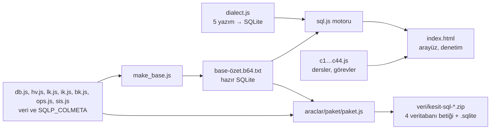

# Kesit SQL · proje rehberi

Yaşayan hâkimiyet dokümanı: projeyi açıp anlatabilmen ve bir mülakatta kararları savunabilmen için. Komutlar ve test ayrıntısı `NASIL.md` içindedir; burada "ne, neden, içeride ne oluyor" var. Doğrulanmamış bilgi **[doğrulanacak]** diye işaretlidir.

## 1. Bir bakışta

| | |
|---|---|
| Ne | Tarayıcıda gerçek bir SQL veritabanıyla Türkçe SQL eğitimi: ders, alıştırma, pratik, SQL Arena, sınav, öğrenme yolları |
| Kimin için | İlk sorgusunu yazacak olandan DBA, veri mühendisi ve sertifika adayına kadar |
| Canlı | https://ysfdurak.github.io/kesit-sql/ |
| Depo | `ysfdurak/kesit-sql`; `kaynak` = site + araçlar, `main` = yalnız site dosyaları |
| Sayılar (Kasım 2026 sonu) | 296 ders, 2.006 ders içi alıştırma (1.514 SQL, 492 seçmeli), 602 pratik görevi, 21 öğrenme yolu, 6 veri seti + operasyon günlüğü |
| Sunucu | Yok. sql.js (SQLite'ın asm.js derlemesi) tarayıcıda çalışır; ilerleme `localStorage` (`sqlpatika.v1`) |
| Lisans | Kod PolyForm Shield 1.0.0, içerik ve veri CC BY-NC 4.0 |

## 2. Sorun ve kararlar

- **Sorun:** SQL öğrenmek için kurulum gerekir; çevrim içi kurslar ya tek bir SQL türünü öğretir ya da sonucu denetlemez.
- **Karar 1, tek motor, beş yazım:** Bütün sorgular SQLite'ta çalışır; SQL Server, PostgreSQL, MySQL, Oracle ve BigQuery yazımı `dialect.js` ile SQLite'a çevrilir. Öğrenci kendi işindeki türü seçer, alıştırma o türün kurallarıyla (harmanlama dahil) denetlenir.
- **Karar 2, sonucu denetle, metni değil:** Öğrencinin sorgusu çalıştırılır, sonuç tablosu örnek çözümünkiyle karşılaştırılır. Sabit sonuç yazmayı (`SELECT 'İstanbul', 28`) gizli varyant yakalar: görev tabloları değiştirilip ikisi yeniden çalıştırılır.
- **Karar 3, taklidi gerçekle sına:** Motor bir taklittir; PostgreSQL (PGlite), SQL Server, MySQL ve Oracle'da çözümler gerçek sunucuda da çalıştırılıp karşılaştırıldı (NASIL.md › 5).
- **Karar 4 (Kasım 2026), kendi veritabanında çalış:** Öğrenci aynı veriyi SSMS, pgAdmin, Workbench ya da SQL Developer'a kurup dersi orada da yapabilsin (13. bölüm).

## 3. Mimari

- Uygulama tek bir `index.html` içindeki kapalı bir işlevde (IIFE) yaşar; içerik dosyaları `window.SQLP_*` dizilerine yazar.
- Veritabanı ilk açılışta bir kez kurulur; her alıştırma `fresh()` ile temiz bir kopya açar, böylece öğrencinin `DELETE`'i başka görevi bozmaz.

## 4. Teknoloji seçimleri

| Seçim | Neden | Elenen |
|---|---|---|
| sql.js asm sürümü | WebAssembly'yi kapatan kurum tarayıcılarında da çalışır | wasm sürümü: daha hızlı ama bazı ortamlarda açılmaz |
| Tek SQLite + çeviri katmanı | Beş ayrı motor tarayıcıya sığmaz | Sunucuda gerçek veritabanları: barındırma, güvenlik ve maliyet |
| Hazır veritabanı (b64) | Tohumu her açılışta çalıştırmak telefonda saniyeler sürüyordu | Tohum SQL'i tarayıcıda çalıştırmak |
| Paketlerde INSERT betiği (CSV değil) | Her araçta aynı komutla kurulur; dosya yolu ve içe aktarma sihirbazı gerekmez | CSV + BULK INSERT/COPY: her veritabanında farklı izin ve yol sorunu |

## 5. Kod turu

- `dialect.js` — `DX.runDialect(db, sql, tür, env)`: yazımı SQLite'a çevirir, T-SQL değişkenleri ve akış kontrolünü yorumlar, hata iletisini o türün biçiminde verir (ör. SQL Server'ın `Msg 130`). `DX.forward`: SQLite yazımını hedef türe çevirir (çözümleri öğrencinin türünde göstermek için).
- `index.html` › `solResult(e, k, d)`: örnek çözümün seçili türdeki sonucunu hesaplar ve önbelleğe alır; `exText` çözüm metnini o türe çevirir. Görev kâğıdı bu ikisini kullanır.
- `c43.js` › `SQLP_SABIT_HEDEFLER`, `noLiteralResult`: sabit sonuçla geçmeyi engelleyen kurallar.
- `c44.js` — 13. bölüm.
- `araclar/denetim/` — `run.js` (asıl test), `sabit_tara.js`, `sabit_regresyon.js`, `pg_denetim.mjs`, `mssql_gen.js`, `db_gen.js`.
- `araclar/paket/paket.js` — 13. bölüm.

## 6. Sunucu ve yayın

Sunucu yok. `kaynak` dalında değişiklik → PR → `main`'e yalnız site dosyaları kopyalanır (NASIL.md › Yayına alma; `veri/` klasörü bu listeye eklendi). GitHub Pages yayınlar.

## 7. Testler (bu turun örneklemi)

| Adım | Beklenen | Gözlenen | Durum |
|---|---|---|---|
| `run.js` yeni ve değişen dersler | Hata yok | 252 çalıştırma, hata yok | ✓ |
| `sabit_tara.js`, `sabit_regresyon.js` | SABIT_GECEN 0, HATA 0 | İlk taslakta 2 görev sabitle geçti; sonucu sayıma bağlanarak düzeltildi, sonra 0 | ✓ |
| `pg_denetim.mjs` (gerçek PostgreSQL) | BILINMEYEN 0 | 1.766 çözüm, BILINMEYEN 0 | ✓ |
| `static.js` | Bilinen uyarı sayıları aynı | Aynı | ✓ |
| Paketler PostgreSQL'de (PGlite) ve MariaDB 10.11'de | 7 paket hatasız, satır sayıları tutar | Tuttu; Türkçe harfler doğru | ✓ |
| Anadolu Market paketi SQL Server'da (Windows, SSMS 18, 28 Kasım 2026) | Hatasız kurulum, DOGRULAMA.md tutar | 10 tablonun satır sayısı ve kontrol toplamları tuttu | ✓ |
| Diğer paketler SQL Server'da, paketler Oracle'da | Hatasız kurulum | Denenmedi | **[doğrulanacak]** |
| 296 dersin görev kâğıdı | Hesaplanamayan görev yok | 0 | ✓ |
| Tarayıcı 390 / 1350 px: ders paneli, Veri setleri | Taşma ve hata yok | Yok | ✓ |

> **Burada bir test daha yapalım:** Anadolu Market SQL Server'da doğrulandı. Sıradaki örneklem: pedal-izmir (116 bin satır, SSMS yerine `sqlcmd -i` ile) ve DOGRULAMA.md'yi karşılaştır. Oracle için de bir paket yeter (ayrılmış sözcük sütunu olan operasyon paketi).

## 8. Bilinen sınırlar ve sonraki adımlar

- Görev kâğıdında sıralama istenmeyen görevlerde satır sırası veritabanına göre değişebilir; PostgreSQL'in C harmanlamasında "İstanbul" sona düşer.
- Paketlerdeki `sys_*`, `msdb_*` tabloları gerçek sistem görünümlerinin kopyasıdır; gerçek SQL Server'da öğrenci `sys.dm_*` yazarsa kendi sunucusunun gerçek değerlerini görür.
- Pedal İzmir paketi büyük (~16 MB). **Şöyle daha iyi olur:** bisiklet yolculuklarının 13.200 satırlık küçük sürümü (uygulamanın telefon kipi) ayrı bir paket olarak da verilebilir.

## 9. Mülakat soruları

1. **Beş SQL türünü tek motorla nasıl destekliyorsun?** Çeviri katmanı yazımı SQLite'a çevirir; türe özgü davranışlar (harmanlama, tamsayı bölmesi, hata iletisi) taklit edilir ve gerçek sunucularla karşılaştırılarak düzeltilir.
2. **Öğrenci sonucu ezbere yazarsa?** Gizli varyant: görevin tabloları değiştirilip çözüm ve cevap yeniden çalıştırılır; sabit sonuç değişmediği için düşer. `sabit_tara.js` her görev için bunu otomatik dener.
3. **Paketlerde türleri nasıl seçtin?** Uygulamanın Veri setleri sayfasının kullandığı mantıksal türlerden (`money` → `DECIMAL(12,2)`, `datetime` → `DATETIME2`/`TIMESTAMP`): öğrencinin sayfada gördüğü CREATE TABLE ile kurduğu tablo aynı olsun diye.
4. **Yabancı anahtarlar neden en sonda?** Veriyi yüklemeden önce eklenirse sıra ve kirli veri yüzünden kurulum yarıda kalır. Yükleme bitince veriye uyanlar eklenir, uymayanlar belgelenir.
5. **Oracle'da sütun adlarını neden tırnakla ve büyük harfle yazdın?** Ayrılmış sözcükle çakışan sütun (ör. `resource`) tırnaksız tanımlanamaz; büyük harf tırnaklı ad, tırnaksız yazılan adla aynı davranır.

## 10. Kendini test et

Görev kâğıdındaki beklenen sonuç nereden geliyor?
Tarayıcıda, aynı motorla: <code>solResult</code> örnek çözümü seçili SQL türünde temiz bir veritabanı kopyasında çalıştırır.

Bir görev neden "sabit sonuçla geçti" diye işaretlendi ve nasıl düzeltildi?
Sonuç tek satırdı ve gizli varyantta silinen satırlar sonucu değiştirmiyordu. Sonuç sayıma (COUNT, SUM) bağlandı; varyantta değişti, sabit cevap düştü.

SQL Server neden <code>SUM(CASE WHEN NOT EXISTS (...))</code> sorgusunu reddetti?
SQL Server toplama işlevinin içinde alt sorguya izin vermez (Msg 130). Motor bu hatayı taklit eder; çözüm alt sorguyu LEFT JOIN'e taşımaktır.

## 11. Elle yapılacak alıştırma

**Kod (15 dk):** `c44.js` içinde `tarih` dersine bir görev ekle: "2023'te kayıt olan müşteri sayısı". Sonra `cd araclar/denetim && FILTER='^tarih$' node run.js` ve `FILTER='^tarih#' node sabit_tara.js`.

**5 dakikalık demo:** (1) Bir derste SQL türünü PostgreSQL'den SQL Server'a çevir, aynı görevin yazımının değiştiğini göster. (2) Yanlış bir sorgu yaz, sonuç karşılaştırmasını göster. (3) Sabit sonuç yaz, reddedildiğini göster. (4) Ders sayfasından görev kâğıdını indir. (5) Veri paketini aç, `postgresql.sql`'i göster.

## 12. Değişiklik günlüğü

| Tarih | Değişiklik |
|---|---|
| 2026-11-08 | Sabit sonuç düzeltmesi (c43.js) |
| 2026-11-21 | Gerçek SQL Server 2019 denetimi |
| 2026-11-27 | Kendi veritabanında çalış paketleri ve görev kâğıdı; c44.js ile 57 görev ve şema tasarlama; bu rehber |
| 2026-11-28 | Anadolu Market paketi Windows SQL Server'da (SSMS 18) kuruldu ve doğrulandı; DOGRULAMA.md'ye durum satırı (`paket.js` › `DOGRULANDI`) |

## 13. Kendi veritabanında çalış ve uygulamalı görev turu (Kasım 2026)

**Neden:** Power BI ve Excel'de "Desktop'ta çalış" paketi vardı; SQL'de veri indirilemiyordu. 24 ders (DBA, köprü, sertifika) yalnız seçmeliydi.

**Yapılanlar:**
1. `araclar/paket/paket.js`: 7 veri paketi (Veri setleri sayfasındaki türlerle). Pakete düşmeyen tablo olursa betik durur, böylece yeni bir veri seti unutulmaz.
2. Ders sayfasında **Kendi veritabanında çalış** paneli: dersin kullandığı paketler (`tablesIn` ile tespit) ve seçili SQL türünde görev kâğıdı. Veri setleri sayfasında bütün paketler.
3. `c44.js`: 57 görev. DBA dersleri gerçek iş sorularıyla (RPO, bakım kararı, engelleme kökü, rol üyeliği); şema tasarlama (`check` ile yapı denetimi).

**Karar ve sonucu:**
- İlk taslakta sonucu 0 ya da boş çıkan görevler (ör. "rolü olmayan kullanıcı") değiştirildi; boş sonuç tahminle bulunur, öğretmez.
- SQL Server'ın toplama içinde alt sorgu yasağına takılan bir çözüm LEFT JOIN'e çevrildi; görev metnine bu not eklendi.
- **Şöyle daha iyi olur:** "Yeni alıştırma türleri" için ayrı bir arayüz yapılmadı; incelemede şema (DDL + `check`), plan (`plan`) ve hata ayıklama (`sik-hatalar`, `hata-ayiklama`) görevlerinin zaten olduğu görüldü. Eksik olan şema tasarlama görevleri eklendi.
